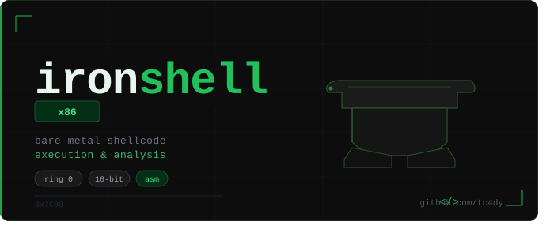

# ironshell-x86 – Bare-Metal Shellcode Sandbox

**ironshell-x86** is a bare-metal x86 shellcode execution and analysis environment written entirely in 16-bit Assembly. It runs directly from a bootable disk image — no OS, no runtime, no libc. Just raw silicon.

[](#)
[](#)
[](#)
[](#)
[](#)
[](#)

---

## [>>] Features

- [+] **2-Stage Bootloader** — Stage 1 MBR loads the loader via LBA Extended Read (`AH=42h`) with a 3-attempt retry mechanism. Stage 2 loads the core engine, sandbox, theme, and filter modules from disk.
- [+] **Modular Directory Structure** — Code is strictly separated into `boot/`, `config/`, `core/`, `lib/`, and `ui/` for maintainability and isolated testing.
- [+] **TUI Shell** — Full interactive terminal UI with a dual-panel VGA layout, command history (↑↓), page scroll (PgUp/PgDn), and a live execution log.
- [+] **8 Injectable Payloads** — MSGBOX, MEMWALK, PORTPROBE, STACKSMASH, NXPROBE, CPUINFO, IVTDUMP, MEMMAP.
- [+] **Sandbox v2.1.7** — 4 enforcement policies, dynamic opcode scanning up to 512 bytes, `CLI`/`STI` protected IVT snapshot & auto-restore, and register integrity checks (SS, DS, ES, SP).
- [+] **Theme Engine** — 5 color themes (COLOR, MONO, HACKER, RETRO, STEALTH) loaded as a standalone module at `0xB000`, accessed via a stable API jump table.
- [+] **Log Filter System** — 6 filter modes (ALL, INFO, WARN, ERROR, SUCCESS, ACCENT) loaded as a standalone module at `0xC000`.
- [+] **Hardware Analysis** — CPUID vendor/brand/feature detection, A20 gate test, E820 memory map, conventional memory sizing.
- [+] **Serial Debugging** — Integrated COM1 output for printf-style debugging via QEMU's `-serial stdio` flag.
- [+] **Error Tracking** — Typed error codes with descriptions, accessible via the `errors` command.
- [+] **Clean Build System** — NASM + QEMU Makefile with GDB debug stub, ndisasm disassembly, and hard binary size validation for all 6 modules.

---

## Schematic of the Working and Execution Logic



---

## [CD] Installation

### 1. Clone the repository

```bash
git clone https://github.com/tc4dy/ironshell-x86.git
cd ironshell-x86
```

### 2. Install dependencies

```bash
sudo apt install nasm qemu-system-x86
```

### 3. Build and run

```bash
make
make run
```

---

## Usage

```bash
make              # Build all binaries and assemble disk image
make run          # Launch in QEMU (terminal/curses mode)
make run-sdl      # Launch in QEMU (SDL window)
make debug        # Launch with GDB stub on port :1234
make disasm       # Disassemble all binaries via ndisasm
make clean        # Remove all build artifacts
make check        # Verify required tools are installed
```

---

## [-<] Shell Commands

Once booted in QEMU, the interactive shell accepts:

| Command | Description |
|---|---|
| `list` | List all available payloads with index and risk flag |
| `sel <n> [arg]` | Select a payload by index; optional runtime argument |
| `run` | Execute the currently selected payload through the sandbox |
| `sandbox` | Re-run all sandbox environment checks |
| `dump <hex>` | Hexdump 32 bytes at a given memory address |
| `info` | Display system memory layout and load addresses |
| `clear` | Clear the execution log panel |
| `theme <1-5>` | Apply a color theme |
| `themes` | List all available color themes |
| `filter <0-5>` | Set log output filter by color category |
| `filters` | List all available filter modes |
| `errors` | Display last error code and description |
| `help` | Show full command reference |

> **Tip:** Use ↑ / ↓ arrow keys to navigate command history. Use PgUp / PgDn to scroll the execution log panel.

---

## [-/] Payload Reference

| # | Name | Description | Risk |
|---|---|---|---|
| 0 | `MSGBOX` | Writes a small MOV/RET stub at 0xA000 and executes it | [+] Safe |
| 1 | `MEMWALK` | Walks and dumps the BIOS Data Area (0x0400+) | [+] Safe |
| 2 | `PORTPROBE` | Samples 8 I/O ports starting at the given hex port (default `0x03F8`) via `IN` | [+] Safe |
| 3 | `STACKSMASH` | Writes canary pattern to stack and verifies integrity | [!] Caution |
| 4 | `NXPROBE` | Tests NX/DEP enforcement by executing a RET stub at 0xA000 | [+] Safe |
| 5 | `CPUINFO` | Full CPUID enumeration — vendor, brand, stepping, SSE/AVX | [+] Safe |
| 6 | `IVTDUMP` | Dumps N Interrupt Vector Table entries; default 16 (INT 0–15) | [+] Safe |
| 7 | `MEMMAP` | Queries E820 system memory map via INT 15h; falls back to INT 12h | [+] Safe |

**Payload arguments** — use `sel <n> <arg>` before `run`:

| Payload | Argument | Example |
|---|---|---|
| `PORTPROBE` | Starting I/O port (hex) | `sel 2 03F8` |
| `STACKSMASH` | Canary depth (decimal, 1–16) | `sel 3 8` |
| `IVTDUMP` | Entry count (decimal, 1–256) | `sel 6 32` |

---

## Theme System

5 built-in color themes, switchable live without reboot:

| # | Name | Description |
|---|---|---|
| 1 | `COLOR` | Full 16-color CGA palette (default) |
| 2 | `MONO` | Monochrome white-on-black |
| 3 | `HACKER` | Green phosphor terminal |
| 4 | `RETRO` | Amber CRT display |
| 5 | `STEALTH` | Near-invisible dark mode |

```text
theme 3       # Switch to hacker green
themes        # List all themes
```

The theme engine loads as a standalone module at **0xB000**. All 10 UI color slots (normal, bright, success, error, warn, accent, dim, selected, title, status) are remapped on theme change, and the entire screen is redrawn immediately.

---

## [>_] Log Filter System

6 filter modes to control what the log panel shows:

| # | Name | Shows |
|---|---|---|
| 0 | `ALL` | All log entries (default) |
| 1 | `INFO` | Dim and accent entries only |
| 2 | `WARN` | Warning entries only |
| 3 | `ERROR` | Error entries only |
| 4 | `SUCCESS` | Success entries only |
| 5 | `ACCENT` | Accent-colored entries only |

```text
filter 3      # Show errors only
filters       # List all filter modes
```

The filter engine loads as a standalone module at **0xC000**. Filtering is applied at render time — all log entries are preserved in the buffer regardless of the active filter.

---

## [#] Sandbox v2.1.7

The sandbox module (`core/sandbox.asm`) loads at `0x9000` and enforces one of four active policies:

| Policy | Value | Behavior |
|---|---|---|
| `POLICY_ALLOW_ALL` | `0x00` | All payloads execute without restriction |
| `POLICY_BLOCK_DANGER` | `0x01` | The payload flagged `DANGEROUS` (STACKSMASH) is blocked *(default)* |
| `POLICY_AUDIT_ONLY` | `0x02` | All payloads execute; violations are logged only |
| `POLICY_LOCKDOWN` | `0x03` | No execution permitted under any condition |

Pre-execution analysis (v2.1.7) includes:

- **CPUID detection** — verifies CPU supports CPUID before any feature query.
- **Opcode scanning** — detects `IN`/`OUT`, `CLI`, `STI`, `HLT`, `WBINVD`, `RDMSR`/`WRMSR` across up to 512 bytes of payload.
- **Hard blocks** — payloads containing `HLT` or privileged prefixes (`0x0F 0x01`, `0x0F 0x30`, `0x0F 0x32`) are blocked regardless of policy (system freeze risk).
- **IVT snapshot + auto-restore** — all 256 IVT entries are snapshotted before execution. Vector modifications are auto-restored with `CLI`/`STI` interrupt protection to prevent race conditions.
- **Register integrity** — verifies `SS`, `DS`, `ES`, and `SP` state post-execution; violations increment the policy score penalty.
- **Bounds check** — confirms payload dispatch address is within `0xA000–0xAFFF`.
- **Policy scoring** — a 0–100 score tracks cumulative violation weight across the session.

Every payload is pre-scanned by `sandbox_entry` before dispatch and post-audited by `sandbox_post_exec` after return.

---

## Memory Layout

```text
0x00000 – 0x003FF  Interrupt Vector Table (IVT)
0x00400 – 0x004FF  BIOS Data Area (BDA)
0x07C00 – 0x07DFF  boot/stage1.asm     MBR bootloader (512 bytes)
0x07E00 – 0x085FF  boot/loader.asm     Loader module (2048 bytes)
0x09000 – 0x0AFFF  core/sandbox.asm    Protection & analysis layer (8192 bytes)
0x0A000 – 0x0AFFF  [EXEC]              Shellcode injection target
0x0B000 – 0x0B3FF  lib/theme.asm       Theme engine (1024 bytes)
0x0B800 – 0x0BFFF  VGA Text Memory     (80×25, mode 0x03)
0x0C000 – 0x0C3FF  lib/filter.asm      Log filter module (1024 bytes)
0x10000 – 0x17FFF  core/stage2.asm     Execution engine + TUI (32768 bytes)
```

> **Note:** `stage2.asm` is relocated to `0x10000` (Segment `0x1000`) to resolve memory overlaps with the sandbox and UI modules, leaving a clean 32KB workspace.

---

## [i] Error Codes

The `errors` command shows the last typed error code and a plain-text description:

| Code | Name | Description |
|---|---|---|
| `0x00` | `ERR_NONE` | No error |
| `0x01` | `ERR_DISK` | Disk read failure during load |
| `0x02` | `ERR_BOUNDS` | Address outside permitted range |
| `0x03` | `ERR_SANDBOX_BLOCK` | Sandbox blocked execution |
| `0x04` | `ERR_BAD_ARG` | Invalid command argument |
| `0x05` | `ERR_OOB` | Index out of range |
| `0x06` | `ERR_NO_PAYLOAD` | No payload selected |
| `0x07` | `ERR_BAD_ADDR` | Invalid hex address for dump |
| `0x08` | `ERR_THEME_INVALID` | Theme index out of range (1–5) |
| `0x09` | `ERR_FILTER_INVALID` | Filter index out of range (0–5) |
| `0x0A` | `ERR_E820_FAIL` | E820 INT 15h memory query failed |

---

## Quick Start (Automated)

The fastest way to boot **ironshell-x86** is the automated setup script:

```bash
curl -fsSL https://raw.githubusercontent.com/tc4dy/ironshell-x86/main/autosetup.sh -o autosetup.sh
chmod +x autosetup.sh
./autosetup.sh
```

The script handles cloning, dependency installation, building, and launching QEMU in a single command.

### Script Options

| Flag | Description |
|---|---|
| `-k`, `--keep` | Preserve the temporary workspace on exit (useful for debugging) |
| `-h`, `--help` | Show usage information |

### Notes

- The temporary workspace is created with `mktemp -d -t ironshell-XXXXXX` and removed automatically on exit unless `-k` is passed.
- QEMU exits via `Ctrl+A` followed by `X` when running in curses mode.

---

## [dbg] Debug with GDB

```bash
make debug
```

Then in a second terminal:

```bash
gdb
(gdb) target remote :1234
(gdb) set architecture i8086
(gdb) break *0x7c00
(gdb) continue
```

Step through the MBR byte by byte, inspect registers, and trace the full boot sequence. Stage 2 entry is at `0x10000`; sandbox entry is at `0x9000`.

---

## Requirements

- `nasm` — Netwide Assembler
- `qemu-system-i386` — x86 system emulator
- `ndisasm` — for `make disasm`, included with NASM package

---

## File Structure

```text
ironshell-x86/
├── boot/
│   ├── stage1.asm          # MBR bootloader
│   └── loader.asm          # 2nd stage loader
├── config/
│   ├── errors.asm          # Error code definitions
│   ├── memory.asm          # Memory map and load addresses
│   └── policies.asm        # Sandbox policy constants
├── core/
│   ├── ivt.asm             # IVT snapshot/diff routines
│   ├── payloads.asm        # 8 payload implementations
│   ├── sandbox.asm         # Protection layer
│   ├── stage2.asm          # Main execution engine
│   └── sysinfo.asm         # CPUID, A20, E820 checks
├── lib/
│   ├── disk.asm            # LBA disk I/O wrapper
│   ├── filter.asm          # Log filter engine
│   ├── math.asm            # Hex/Decimal conversion
│   ├── serial.asm          # COM1 serial output
│   ├── string.asm          # String manipulation
│   └── theme.asm           # Color theme engine
├── ui/
│   ├── input.asm           # Keyboard and history
│   ├── log.asm             # Ring buffer log
│   ├── menu.asm            # TUI frames and panels
│   └── screen.asm          # VGA text mode routines
├── Photos/
│   ├── ironshell_x86_banner.svg
│   └── update_scheme.png
├── .gitignore
├── autosetup.sh
├── CHANGELOG.md
├── LICENSE
├── Makefile
└── README.md
```

---

## Version History

**v2.1.7** — current

### Architectural Changes

- Relocated `stage2.asm` to `0x10000` (Segment `0x1000`) to resolve critical memory overlaps with `sandbox`, `theme`, and `filter` modules.
- Refactored monolithic source files into a modular directory structure (`boot/`, `core/`, `lib/`, `ui/`, `config/`). Each module has a single responsibility, improving maintainability and isolated testing.
- Centralized all memory addresses, load offsets, and error codes into `config/*.asm`, eliminating hardcoded magic numbers across the codebase.
- Implemented stable `jmp near` API jump tables for `theme.asm`, `filter.asm`, and `sandbox.asm`. Cross-segment calls use `call far` and `retf` to enforce strict boundary execution.

### Security & Stability

- **IVT Race Condition Fixed:** Added `CLI`/`STI` interrupt protection around the IVT auto-restore routine. This prevents system crashes if a hardware interrupt fires while the table is being rewritten.
- **Opcode Scanner Hardened:** Increased scan depth from 128 to 512 bytes to catch larger payloads. Added strict hard-blocks for privileged instructions (`HLT`, `WRMSR`, `RDMSR`, `LGDT`, `WBINVD`) regardless of the active policy level.
- **Boot Sequence Hardened:** Replaced legacy CHS disk reads (`AH=02h`) with LBA Extended Read (`AH=42h`). Integrated a 3-attempt retry loop and disk reset (`AH=00h`) on failure to ensure reliable loading on modern BIOS/UEFI systems.
- **Register Integrity Expanded:** The sandbox now snapshots and verifies `ES` (Extra Segment) and `SP` (Stack Pointer) state post-execution, in addition to `DS` and `SS`. Any unauthorized modification increments the policy score penalty.
- **Payload Bounds Enforced:** Strict runtime checks ensure the payload dispatch address is always within the `0xA000–0xAFFF` executable region.
- **Serial Debugging Added:** Implemented COM1 routines (`lib/serial.asm`) to allow printf-style debugging via QEMU's `-serial stdio` flag, reducing reliance on GDB for simple traces.

### Fixes

- Fixed history navigation string corruption in `ui/input.asm` caused by `scasb` pointer miscalculation.
- Fixed stack corruption in `payload_memwalk` caused by an unbalanced `BX` increment.
- Fixed `stage1.asm` drive number handling by storing `DL` in a dedicated memory location (`BOOT_DRIVE_ADDR`) before any BIOS call could clobber it.
- Hardened the `Makefile` with strict byte-size validation for every module (e.g., `stage1.bin` must be exactly 512 bytes), aborting compilation if limits are exceeded.

**v1.0** — Initial release

- 2-stage bootloader, 7 payloads, basic sandbox with 4 policies.
- For the full changelog across all versions, see [CHANGELOG.md](https://changelog.md/).
